# 4. Release a secret only for approved Init-Data

Run `make demo4` (or `bash docs/04-reference-secret/demo.sh`). This stage provisions
its own Trustee resources and does not need a successful demo3 run.
See [demo-magic setup and options](../README.md#run-with-demo-magic).

Both pods use the same BusyBox image, command, and signed sealed-secret reference.
Their guest policies differ by one line:

```diff
-default ExecProcessRequest := false
+default ExecProcessRequest := true
```

- [busybox-secret.yaml](busybox-secret.yaml) embeds [busybox-policy.rego](busybox-policy.rego), which denies exec. KBS approves this Init-Data hash, so the guest fetches the secret, prints `busybox-demo-secret-value`, and stays running.
- [busybox-secret-denied.yaml](busybox-secret-denied.yaml) embeds [busybox-policy-exec.rego](busybox-policy-exec.rego), which allows exec. Its different Init-Data hash fails the KBS policy, so the guest cannot fetch the secret and the container does not start.

The manifests differ only in pod name and Init-Data. Both guest policies allow container creation and image pulling; this stage
does not restrict image digests. This demonstrates KBS secret denial due to changed
Init-Data. The executable variant means allowing `kubectl exec`; the image and
file permissions remain identical.

## Secret interaction diagram

```mermaid
flowchart LR
    subgraph setup ["1. Presenter setup"]
        keygen["Generate signing key pair"]
        privateKey["Private signing key stays with presenter"]
        provision["Upload disposable secret and configure release policy"]
    end

    subgraph kubernetes ["2. Kubernetes stores the reference"]
        sealedRef["Secret sealed-secret: signed JWT reference"]
    end

    subgraph guest ["3. Confidential guest VM"]
        unsealer["Guest unsealer receives sealed reference"]
        signatureCheck["Verify JWT signature"]
        attestation["Attestation agent collects guest evidence"]
        fetchSecret["Request referenced secret"]
        pod["BusyBox pod: PROTECTED_SECRET then start container"]
        blocked["Secret denied: container never starts"]
    end

    subgraph trustee ["Trustee"]
        publicKey[("Public verification key: default/test_signing/busybox_public")]
        secretValue[("Secret value: default/test_secrets/busybox")]
        attestationService["Attestation Service evaluates evidence"]
        releasePolicy{"KBS: attestation satisfies release policy?"}
    end

    keygen --> privateKey
    keygen -->|"Upload public key"| publicKey
    privateKey -->|"Sign reference only"| sealedRef
    provision -->|"Store value"| secretValue
    provision -->|"Configure release policy"| releasePolicy
    sealedRef -->|"Inject sealed JWT"| unsealer
    unsealer --> signatureCheck
    publicKey -->|"Fetch verification key"| signatureCheck
    signatureCheck -->|"Valid signature"| fetchSecret
    fetchSecret -->|"Trigger attestation"| attestation
    attestation -->|"Submit evidence"| attestationService
    attestationService -->|"Verified claims"| releasePolicy
    fetchSecret -->|"kbs:///default/test_secrets/busybox"| releasePolicy
    secretValue -->|"Requested resource"| releasePolicy
    releasePolicy -->|"Allow: release to guest"| pod
    releasePolicy -->|"Deny"| blocked

    style setup fill:#FFECBD,stroke:#FFC943
    style kubernetes fill:#D9D9D9,stroke:#B3B3B3
    style guest fill:#CDF4D3,stroke:#66D575
    style trustee fill:#C2E5FF,stroke:#3DADFF
    style blocked fill:#FFCDC2,stroke:#FF7556
```



The private/public pair signs and verifies the reference; it does not encrypt or
decrypt the secret value. The sealed JWT identifies the KBS secret resource and
the public signing-key resource. Kubernetes stores that reference, while the
value stays in Trustee until the guest is authorized. The guest verifies the
signature and unseals the reference before starting the container.

Attestation supplies the Init-Data claim used by the KBS release policy.
The default dev runtime uses sample evidence, **not hardware-verified attestation**.
For a hardware-backed confidential guest, use the TDX runtime and hardware
policy described below, which also requires an affirming attestation result.

Both demo pods use the same signed reference. Enabling exec changes the guest
policy and therefore its Init-Data hash: KBS denies the modified pod the secret,
so its container never starts. The approved pod receives the value as
`PROTECTED_SECRET` and deliberately prints the disposable demo value to its logs.

## Automated presenter setup

Requires a Linux x86_64 presenter host with `helm`, `kubectl`, `oras`, Python 3,
`base64`, and Mike Farah's `yq` v4. Use a policy-enabled `kata-qemu-coco-dev`
runtime with guest image pulling. The script:

1. Installs or upgrades Trustee chart `0.21.0` in `coco-trustee` and waits for readiness.
2. Saves the bootstrap admin token without displaying its contents. [kbs-env.sh](kbs-env.sh) discovers the KBS Service endpoint and prints only the exported `KBS_HOST`, `KBS_PORT`, and `KBS_URL` variables.
3. [install-clients.sh](install-clients.sh) downloads the KBS client and sealed-secret CLI using ORAS and prints only the exported `KBS_CLIENT` and `SECRET_TOOL` paths. Installation output is saved to `.demo/demo4/install-clients.log` and displayed on failure.
4. Creates a signing key and disposable value, uploads the value and public key, and stores a signed reference in the Kubernetes Secret `sealed-secret`.
5. Packages both policies as Init-Data and approves only the hash for the policy denying exec.
6. Replaces the KBS resource policy, starts the approved pod, and checks the printed value.
7. Compares the guest policies after successful retrieval, then starts the modified pod and waits for a secret-access rejection. A timeout alone does not count as proof; inspect guest and KBS logs if the runtime does not surface the denial in pod events.

All tools, credentials, signing keys, and generated manifests live under the
Git-ignored `.demo/demo4/`, with private file permissions. The plaintext value and
private signing key are never put in pod manifests. Logs deliberately expose
only the disposable demo value.

Trustee installs in the current Kubernetes context by default. Set
`TRUSTEE_CONTEXT` to install it in a different cluster. The endpoint must be
reachable from both the presenter shell and guest. Override it when needed:

```sh
TRUSTEE_CONTEXT=trusted-cluster KBS_URL=http://REACHABLE_KBS_HOST:8080 make demo4
```

`KBS_CLIENT_IMAGE` and `SECRET_CLI_IMAGE` override the OCI artifacts. Defaults:
`ghcr.io/confidential-containers/staged-images/kbs-client:latest` and
`ghcr.io/confidential-containers/guest-components/secret-cli:latest`.

## Init-Data and KBS policy

```sh
python3 docs/04-reference-secret/prepare-init-data.py
```

This regenerates both embedded Init-Data annotations and updates both KBS policies
with **only the approved policy's hash**. Repeat after changing either policy.
Hashes cover the exact uncompressed TOML bytes, including whitespace. The dev
sample verifier reports SHA-384 in base64; the hardware policy uses hex.

[kbs-resource-policy.rego](kbs-resource-policy.rego) allows the public signing key
at `default/test_signing/busybox_public`. It releases only
`default/test_secrets/busybox`, requiring the approved Init-Data hash in sample
claims. Missing or changed hashes and all other resource paths are denied.

The script installs this policy using the KBS client:

```sh
"$KBS_CLIENT" --url "$KBS_URL" config --admin-token-file "$ADMIN_TOKEN_FILE" \
  set-resource-policy --policy-file docs/04-reference-secret/kbs-resource-policy.rego
```

This replaces the entire existing KBS resource policy. The guest unseals the
reference before starting the container; the denied pod therefore cannot start
even though its policy would allow the image and exec.

## Dev versus hardware

The default dev runtime demonstrates the release flow. Its sample claims are
not hardware-verified and can be forged by a malicious client. Use the disposable
demo value only. It provides no hardware-backed protection against the host.

For verified TDX release:

1. Set both templates' runtime annotation and `runtimeClassName` to your installed policy-enabled TDX runtime with guest image pulling.
2. Configure Trustee with trusted reference measurements and require an `affirming` EAR token with verified TDX `init_data` claims.
3. Regenerate Init-Data and keep an administrator-controlled copy of the approved hash.
4. Select [kbs-resource-policy-hardware.rego](kbs-resource-policy-hardware.rego):

```sh
KBS_RESOURCE_POLICY=docs/04-reference-secret/kbs-resource-policy-hardware.rego make demo4
```

The hardware policy requires affirming TDX evidence and the approved Init-Data
hash. Enabling exec changes that hash and denies release until an administrator
approves it. Release is bound to the guest policy, not a unique pod UID or the
entire Kubernetes manifest.

## Cleanup and troubleshooting

Run `make cleanup` before repeating demos with changed pod specifications. It
deletes the demo pods and Kubernetes Secret, but leaves Trustee, its stored
resources, and `.demo/` intact. Restore the previous KBS resource policy after
a temporary demo. Delete `.demo/demo4/` when its credentials and keys are no
longer needed.

- Public-key 403: check the installed policy and signing-key resource path.
- Approved pod gets secret 403: regenerate Init-Data, reinstall the resource policy, and check the hash encoding and selected verifier/runtime.
- Modified pod starts: inspect the active KBS policy and confirm only the original hash is approved.
- Container creation fails before secret access: check guest image pulling and the runtime's policy support.
- No denial visible in pod events: inspect guest/runtime and KBS logs for the failed resource request and mismatched Init-Data claim.
